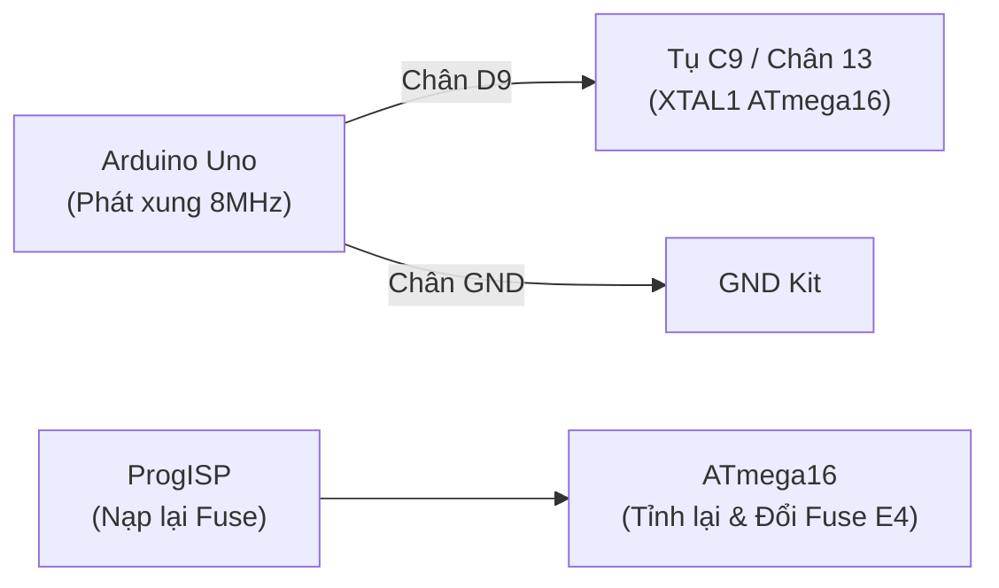

# NHẬT KÝ SỰ CỐ & HƯỚNG DẪN XỬ LÝ LỖI (TROUBLESHOOTING LOG)

> **Dự án:** Mạch đo nhiệt độ & cảnh báo sử dụng ATmega16 và Cảm biến DHT11  
> **Nền tảng phần cứng:** Kit phát triển vi điều khiển AVR - Viện Điện tử - Viễn thông, ĐHBK Hà Nội  
> **Công cụ:** ProgISP 1.72, avr-gcc, avrdude, VS Code / Antigravity IDE  

Tài liệu này tổng hợp toàn bộ các sự cố điển hình đã gặp phải trong quá trình làm mạch thực tế, bản chất kỹ thuật và quy trình xử lý chuẩn xác để tra cứu nhanh.

---

## 1. BẢNG THÔNG SỐ VÀNG CỦA DỰ ÁN (CHEAT SHEET)

| Mục | Giá trị chuẩn | Ý nghĩa kỹ thuật |
| :--- | :--- | :--- |
| **Vi điều khiển** | `ATmega16` / `ATmega16A` | Đóng gói DIP-40 chân cắm |
| **Nguồn xung nhịp** | **Dao động nội 8.0 MHz** | *Internal RC Oscillator* (Kit không cần gắn thạch anh ngoài) |
| **High Fuse Byte** | **`0xD9`** | Bit 6 (`JTAGEN`) = 1 $\rightarrow$ **Đã tắt JTAG** để giải phóng PORT C |
| **Low Fuse Byte** | **`0xE4`** | `CKSEL3..0 = 0100` $\rightarrow$ Chạy dao động nội **8MHz**, delay 64ms |
| **Mã Fuse nạp ProgISP** | **`0xD9E4`** | Định dạng `[High][Low]` nhập thẳng vào ô *Program Fuse* |
| **Chân Cảm biến DHT11** | **`PA1`** (Chân 39 MCU) | Tín hiệu 1-Wire Single-bus, cần trở kéo nội hoặc trở kéo ngoài 4.7k-10k |
| **Giao tiếp LCD 1602** | Chế độ 4-bit bus | Data: `PC4-PC7` (D4-D7) \| Control: `PD5` (RW), `PD6` (RS), `PD7` (EN) |

---

## 2. SỰ CỐ 1: MÀN HÌNH LCD HIỂN THỊ DÒNG ĐẦU CÁC HÌNH CHỮ NHẬT ĐEN, DÒNG 2 TRẮNG TINH

### Triệu chứng:
* Cấp nguồn cho mạch, màn hình LCD 16x2 dòng 1 hiện đầy các khối đen (5x8 pixels), dòng 2 không có gì.
* Màn hình không hiện chữ chào mừng `"DA2: DO NHIET DO"` hay nhiệt độ.

### Bản chất kỹ thuật:
1. **Trạng thái mặc định của chip HD44780:** Khi mới cấp điện và chưa nhận được chuỗi lệnh khởi tạo từ vi điều khiển, LCD mặc định ở chế độ **1 dòng (1-line mode)**. Khi chỉnh biến trở $V_0$, hàng 1 sẽ nổi khối đen. Khi khởi tạo thành công (lệnh `0x28` - 2 dòng), các khối đen này sẽ biến mất.
2. **Xung đột chân JTAG trên ATmega16 (Nguyên nhân chính):**
   * Chân dữ liệu LCD dùng `PC4 - PC7`.
   * Trên ATmega16, `PC2 - PC5` là các chân nạp/gỡ lỗi phần cứng **JTAG**:
     * `PC4` = **TDO** (nối chân D4 LCD)
     * `PC5` = **TDI** (nối chân D5 LCD)
   * Fuse xuất xưởng mặc định bật JTAG (`JTAGEN = 0`). Phần cứng JTAG khóa cứng chân `PC4`, `PC5` ở mức treo, khiến MCU không thể xuất dữ liệu GPIO. LCD bị mất 2 bit dữ liệu nên không bao giờ nhận đúng lệnh khởi tạo.
3. **Độ trễ (Timing) chưa đủ:** Các chip LCD clone (AIP31066, KS0066...) cần thời gian xử lý lệnh khởi tạo dài hơn chip HD44780 gốc.

### Cách xử lý:
1. **Tắt JTAG trong Fuse Bits:**
   * Mở ProgISP $\rightarrow$ nhập ô **Program Fuse: `0xD9E4`** (hoặc mở bảng `...`, chuyển bit **JTAGEN sang `1`**).
   * Tích chọn ô vuông **Program Fuse** và nạp vào chip.
2. **Tắt JTAG bằng phần mềm trong code (`tempsen.c`):**
   * Theo datasheet Atmel, cần ghi thanh ghi `MCUCSR` 2 lần liên tiếp trong vòng 4 chu kỳ CPU:
     ```c
     MCUCSR = (1 << JTD);
     MCUCSR = (1 << JTD);
     ```
3. **Nới lỏng thời gian trễ trong `hunget_lcd.h`:**
   * Tăng delay sau khi cấp nguồn lên 50ms.
   * Gửi 3 lần lệnh `0x30` cách nhau 2 - 5ms.
   * Sau lệnh chuyển 4-bit (`0x20`) và cấu hình 2 dòng (`0x28`), thêm `_delay_ms(2)`.
   * Tăng xung Enable: giữ mức cao 5µs, sau khi kéo thấp delay 100µs.

---

## 3. SỰ CỐ 2: LỖI "CHIP ENABLE PROGRAM ERROR" & CHIP BỊ KHÓA CLOCK ("NGỦ ĐÔNG")

### Triệu chứng:
* Trong ProgISP, bấm **RD** hoặc bấm **Auto** thì bị cửa sổ pop-up đỏ báo: **`Chip Enable Program Error`**.
* Không đọc được Signature `ID: 1E : 94 : 03`.
* Đèn LED trên Kit (LED số 8 / LED cảnh báo) bị tắt ngấm.

### Bản chất kỹ thuật:
* Khi nạp Fuse với **Low Fuse = `0xFF`** (cấu hình thạch anh ngoài tần số cao 8-16MHz).
* Trong khi đó, **Kit của Viện ĐTVT - ĐHBK Hà Nội không hàn thạch anh ngoài** (vị trí `XT1` để trống, 2 tụ cam `C8`, `C9` hở mạch).
* Vi điều khiển lập tức ngắt mạch dao động RC nội để chờ xung từ thạch anh ngoài. Vì không có xung nhịp nhịp tim, **CPU ATmega16 dừng hoạt động hoàn toàn**. Giao diện nạp SPI (MOSI, MISO, SCK) không thể nhận phản hồi từ chip.

### Quy trình cứu chip (Clock Injection bằng Arduino Uno):



1. **Chuẩn bị Arduino Uno:**
   * Nạp code Timer1 CTC phát xung vuông 8MHz trên chân D9:
     ```cpp
     void setup() {
       pinMode(9, OUTPUT);
       TCCR1A = _BV(COM1A0);
       TCCR1B = _BV(WGM12) | _BV(CS10);
       OCR1A = 0; // 16MHz / (2 * 1) = 8MHz
     }
     void loop() {}
     ```
2. **Nối dây sang Kit:**
   * Dây 1: **GND** Arduino $\rightarrow$ **GND** Kit (chung mass).
   * Dây 2: **D9** Arduino $\rightarrow$ dí chạm chắc vào **chân con tụ màu cam C9** (nằm ở hàng chân phía trên chip, giữa `Port-D` và `Port-B`). Con tụ C9 này nối thông trực tiếp với chân 13 (`XTAL1`) của ATmega16.
3. **Thao tác trên ProgISP (tay vẫn giữ dây chạm C9):**
   * Bấm nút **`RD`** $\rightarrow$ Chip nhận lại ID `1E 94 03` ngay lập tức!
   * Sửa ô **Program Fuse** thành: **`0xD9E4`** (`E4` = Trả về dao động nội 8MHz).
   * Tích chọn ô vuông **Program Fuse** $\rightarrow$ Bấm nút **Auto**.
4. **Hoàn tất:** Rút dây Arduino ra cất đi, ATmega16 tự chạy dao động nội 8MHz vĩnh viễn.

---

## 4. SỰ CỐ 3: PROGISP BÁO NẠP THÀNH CÔNG NHƯNG CODE KHÔNG CHẠY (`Flash: 0 / 16384`)

### Triệu chứng:
* ProgISP thông báo: `Erase, Write Flash, Verify Flash, Write Fuse, Successfully done`.
* Nhưng trên mạch không có chữ nào hiện lên, LED không sáng theo logic code.

### Bản chất kỹ thuật:
* Nhìn vào góc dưới bên trái của ProgISP (dưới chữ *Erase*), thấy hiển thị: **`Flash: 0 / 16384`**.
* Điều này có nghĩa là **chưa nạp file code `.hex` vào bộ đệm của ProgISP**.
* Khi bấm Auto, ProgISP chỉ thực hiện lệnh **`Chip Erase`** (xóa sạch toàn bộ Flash trong chip) rồi nạp 0 byte $\rightarrow$ Chip hoàn toàn trắng tinh, không có chương trình để chạy.

### Cách xử lý:
1. Bấm nút **`Load Flash`** ở cột ngoài cùng bên phải của ProgISP.
2. Chọn file code mới nhất: `src/tempsen.hex`.
3. Kiểm tra lại góc dưới bên trái: Con số `0` phải đổi thành **`Flash: 2774 / 16384`** (hoặc dung lượng code tương đương).
4. Bấm lại nút **`Auto`** để nạp thật sự vào chip.

---

## 5. BẢNG ÁNH XẠ CHÂN KẾT NỐI GIẮC J7 VỚI MÀN HÌNH LCD 1602

Theo sơ đồ thiết kế nguyên lý và mạch in của Kit:

| Chân giắc J7 | Chân LCD 1602 | Ký hiệu | Chân MCU ATmega16 | Chức năng |
| :---: | :---: | :---: | :---: | :--- |
| **1** | 1 | `VSS` | GND | Nguồn 0V |
| **2** | 2 | `VDD` | VCC | Nguồn +5V |
| **3** | 3 | `V0` | VR1 (Biến trở) | Điện áp chỉnh độ tương phản hiển thị |
| **4** | 4 | `RS` | **`PD6`** | Chọn thanh ghi (0: Lệnh, 1: Dữ liệu) |
| **5** | 5 | `RW` | **`PD5`** | Chọn chế độ Đọc/Ghi (0: Ghi, 1: Đọc) |
| **6** | 6 | `E` | **`PD7`** | Xung chốt dữ liệu (Enable) |
| **7** | 7 | `D0` | `PC0` | Không dùng trong chế độ 4-bit |
| **8** | 8 | `D1` | `PC1` | Không dùng trong chế độ 4-bit |
| **9** | 9 | `D2` | `PC2` | Không dùng trong chế độ 4-bit |
| **10** | 10 | `D3` | `PC3` | Không dùng trong chế độ 4-bit |
| **11** | 11 | `D4` | **`PC4`** | Dữ liệu bit 4 |
| **12** | 12 | `D5` | **`PC5`** | Dữ liệu bit 5 |
| **13** | 13 | `D6` | **`PC6`** | Dữ liệu bit 6 |
| **14** | 14 | `D7` | **`PC7`** | Dữ liệu bit 7 |
| **15** | 15 | `A` | VCC (qua R) | Cực Anot đèn nền LED Backlight |
| **16** | 16 | `K` | GND | Cực Katot đèn nền LED Backlight |

